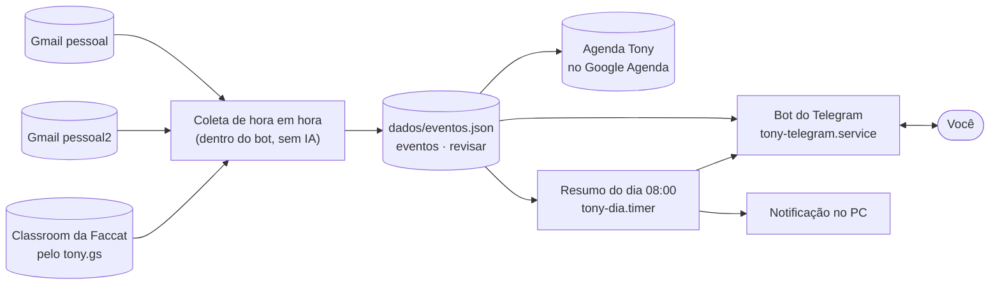

# 🗺️ Tony

O Tony é o meu agente de IA próprio, construído do zero em Python. Esta pasta é a `docs/` do
repositório do código, e aparece no vault como `My-Brain/Tony/`: um mundo próprio, com regras
próprias (o `CLAUDE.md` desta pasta) e nenhum conteúdo cruzando com as outras pastas. Este mapa é o
ponto de entrada.

> [!success] Em produção: v5.0.0 (2026-11-04), no Google Apps Script, 24 horas, sem o notebook
> Assistente de e-mail: três contas (dois Gmails e a Faccat) → datas por código → agenda "Tony" no
> Google → Telegram (`@tony_josias_bot`, por webhook). Coleta de hora em hora e resumo às 08:00 por
> gatilhos. Código em `appsscript/` (JavaScript); o Python fica para as falas de teste e como reserva.
> Modelo: `gemma4:31b` na nuvem do Ollama, só nas perguntas livres.
> Código: [github.com/josiascardosodias-glitch/tony](https://github.com/josiascardosodias-glitch/tony) (público, MIT) ·
> local em `~/projetos/tony` · rodar com `uv run tony`.

> [!important] Trabalho novo vai na branch `develop`
> Regras de branch e de produção em [[Tony - Regras do projeto]]; o que vem depois, em
> [[Tony - Próximas atualizações]].

## Como a v4 funciona

Tudo roda da pasta de produção (`~/projetos/tony-producao`). As datas saem dos e-mails por código
(`tony/datas.py`): a partir de 0,6 de confiança viram evento, de 0,3 a 0,6 vão para o `/revisar` do
Telegram. No Telegram, pergunta de agenda é respondida pelo código; só a pergunta livre vai ao modelo,
que recebe a agenda e nunca o e-mail.

## Projeto — o que nós planejamos (o Tony não lê)

0. [[Tony - Regras do projeto]] — branches `main`/`develop`, produção, IA no mínimo; ler antes de qualquer atualização
1. [[Tony - Como usar e evoluir]] — comandos, onde fica cada coisa e o ciclo de testes
2. [[Tony - Próximas atualizações]] — roadmap vivo: o plano da v4, dúvidas e ideias soltas
3. [[Tony - Briefing v1]] — histórico: o plano da v1
4. [[Tony - Diário de bordo]] — o que foi feito, travou e aprendi em cada sessão
5. [[Tony - Conceito inicial (GPT)]] — histórico: a primeira ideia, substituída pelo briefing

No repositório do código: `DECISOES.md` (cada decisão com o porquê), `CHANGELOG.md` (o que mudou em
cada versão) e `ROADMAP.md` (resumo público).

## Inteligência — o que o Tony lê

A única pasta que o Tony lê (`docs/Inteligência/`, apontada no `config.local.yaml`). Tudo aqui vai
para o modelo na nuvem: só entra o que pode sair da máquina. As notas daqui **não sobem para o
GitHub**: o repositório guarda só os modelos vazios em `modelos/`, e cada pessoa preenche os seus. Uma nota = um assunto, com o prefixo
`Tony - `. Desde a v4 elas vão inteiras no prompt, sem ferramenta para ler sob demanda.

1. [[Tony - Sobre o Josias]] — quem eu sou e como prefiro as respostas
2. [[Tony - Lembretes]] — fatos soltos (o `/lembrar` saiu na v4: edite à mão)
3. Modelos: [[Tony - Sobre mim (modelo)]] e [[Tony - Lembretes (modelo)]]

## Histórico

As notas vieram do Cofre em 2026-11-03 com o histórico do Git (`git log -- docs` mostra desde
2026-10-22). Duas notas antigas que viraram notas do Tony só existem no histórico, em
`docs/historico/`.
